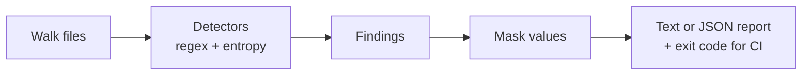

<!--
  README.md
-->

<p align="center">
  <!-- BADGES:START -->
  <a href="https://github.com/sainakakkar2006/pii-secret-scanner/actions/workflows/tests.yml"></a>
  <a href="#"></a>
  <a href="#"></a>
  <a href="#"></a>
  <!-- BADGES:END -->
</p>

# pii-secret-scanner

Author: Saina Kakkar

### Project Description
A DevSecOps command-line tool that catches leaked credentials before they
reach a public repository. It scans a codebase for secret-like content (API
keys, access tokens, passwords, private-key headers), masks the sensitive
values in its output, and returns CI-friendly exit codes so a pipeline can
block a leaky commit automatically.

With `--pii` it also looks for personal data that should not be sitting in a
repo or a log export: US Social Security numbers, payment card numbers, and
email addresses. That part is off by default because most codebases have an
author email in them somewhere and I did not want every build to fail on it.



## What It Detects

Secrets (always on):

| Rule | Severity | Notes |
|---|---|---|
| AWS access key ID | HIGH | `AKIA` + 16 characters |
| GitHub token | HIGH | `ghp_`, `gho_`, `ghu_`, `ghs_`, `ghr_` |
| Google API key | HIGH | `AIza` + 35 characters (Gemini, Maps, Firebase keys all look like this) |
| Slack token | HIGH | `xoxb-`, `xoxp-` and friends |
| Private key block | HIGH | `-----BEGIN ... PRIVATE KEY-----` |
| Secret-like assignment | MEDIUM | Any name containing `api_key`, `secret`, `password`, `passwd` or `token`, including prefixed names like `GEMINI_API_KEY` or `DB_PASSWORD`. Skips references (`os.environ.get(...)`, `${VAR}`, `None`) and doc placeholders (`your-api-key-here`, `changeme`). |
| High entropy token | LOW | 32+ characters, mixes digits with upper and lower case, and has Shannon entropy above 4.0 bits per character |

Personal data (only with `--pii`):

| Rule | Severity | Notes |
|---|---|---|
| US Social Security number | HIGH | `ddd-dd-dddd`, skipping numbers the SSA never issues (000, 666, 9xx area) |
| Payment card number | HIGH | 13 to 19 digits, spaces or dashes allowed, must pass the Luhn check |
| Email address | LOW | Skips `example.com`, `test.com`, `localhost` and GitHub noreply addresses |

If two rules match the same text on a line, only the first (more specific)
one is reported, so a Google key inside `GEMINI_API_KEY = "..."` shows up
once as a HIGH finding and not three times.

Findings are heuristic by design. The goal is to warn loudly before a push,
not to prove a string is a live credential.

## Quick Start

Scan the bundled sample project:

```bash
PYTHONPATH=src python -m secret_scanner scan examples/sample_project --no-fail
```

Write a JSON report (for CI artifacts or tooling):

```bash
PYTHONPATH=src python -m secret_scanner scan examples/sample_project --format json --out reports/findings.json
```

### Example Output

```
2 finding(s)

examples/sample_project/.env.example:1 [MEDIUM] Environment assignment with secret-like name
  value: API_****************-key

examples/sample_project/config.py:1 [MEDIUM] Environment assignment with secret-like name
  value: PASS*****************word
```

The values are masked on purpose. A secret scanner that
echoes full secrets back to the terminal, or into CI logs, would become a
leak vector itself. I kept the first and last few characters visible so you
can still tell which secret it found.

## CLI Reference

The `scan` subcommand takes these options:

| Argument | Default | What it does |
|---|---|---|
| `path` | (required) | File or directory to scan (directories are walked recursively) |
| `--format` | `text` | Report format: `text` or `json` |
| `--out` | none | Write the report to a file instead of only stdout |
| `--pii` | off | Also run the personal-data rules |
| `--no-fail` | off | Always exit with code 0, even when findings exist |

Exit codes: `0` means no findings (or `--no-fail` was set), non-zero means
findings exist.

## CI Integration

Because of the exit-code contract, a single line in a pipeline gates the
build:

```yaml
- run: PYTHONPATH=src python -m secret_scanner scan .
```

If you install the package (`pip install .`) the same thing is available as a
`pii-secret-scanner` command (the old `secret-scanner` name still works).

Use `--no-fail` for report-only runs, for example a nightly job that
collects the JSON reports as artifacts without blocking anyone.

## Project Layout

```
src/secret_scanner/
  cli.py        argument parsing and the scan subcommand
  scanner.py    file walking and running the rules over each line
  rules.py      the detectors (secret rules, PII rules, entropy and Luhn checks)
  reporting.py  text / json formatters and value masking
examples/sample_project/   a fake project with planted "secrets" to scan
tests/                     scanner, rules, reporting, and CLI tests
```

Each rule in `rules.py` is a `Rule` entry: a name, a severity, a regex, and
an optional validator function for checks a regex cannot do (entropy, Luhn,
"is this a placeholder"). Adding a detector means adding one entry to the
list. The scanning engine does not change.

## Verify

```bash
PYTHONPATH=src python -m unittest discover -s tests
```

## Additional Notes

- **v0.1 missed `GEMINI_API_KEY=...`.** The assignment rule started with
  `\b` right before the keyword, and there is no word boundary between `_`
  and `A`. So `API_KEY=...` was caught but `GEMINI_API_KEY=...`,
  `OPENAI_API_KEY=...` and `DB_PASSWORD=...` were not, which is most of the
  names people actually use. v0.2 allows a prefix and a suffix on the name,
  and the test for it lists all four of those names.
- **The "high entropy" rule in v0.1 did not compute entropy.** It was only a
  32+ character regex. Now it computes Shannon entropy and needs more than
  4.0 bits per character. I picked 4.0 because hex can never go above it,
  so git SHAs and checksums do not get flagged. The tradeoff is that a
  secret written in pure hex is missed by this rule.
- **Masking is the part I care about most.** Values are always printed
  with the middle hidden. A scanner that echoes full secrets into CI logs
  becomes the leak.
- My [mcpscan](https://github.com/sainakakkar2006/mcpscan) project reuses
  these regexes and `mask_secret` for its exfiltration check.

## License

MIT. See the [LICENSE](LICENSE) file.
